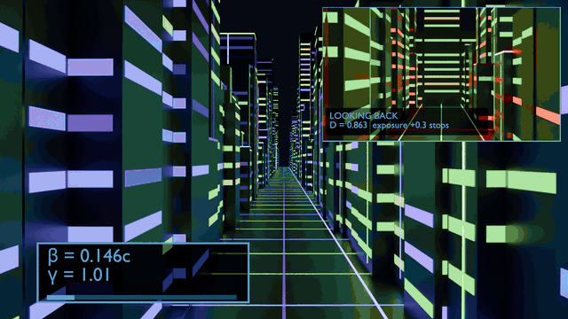
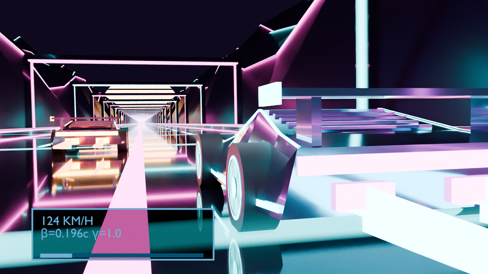
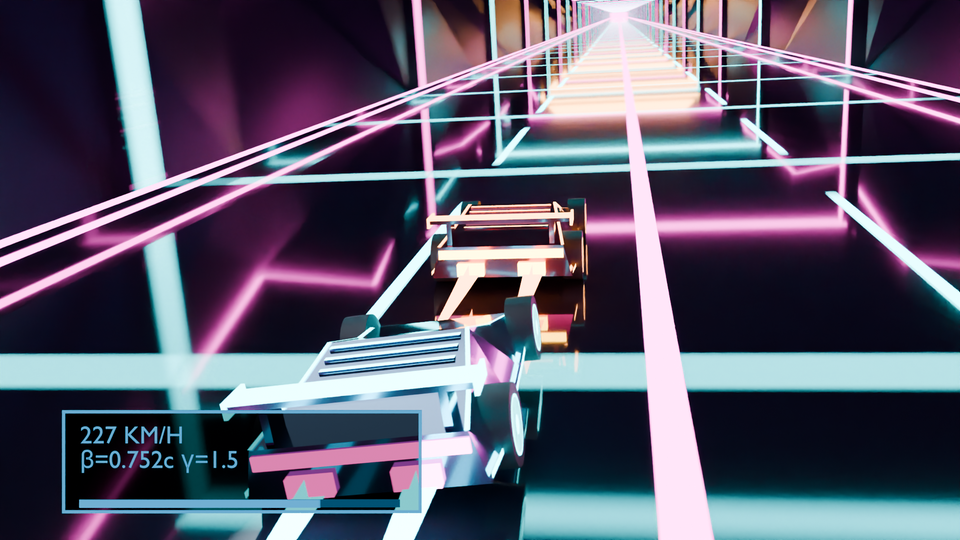
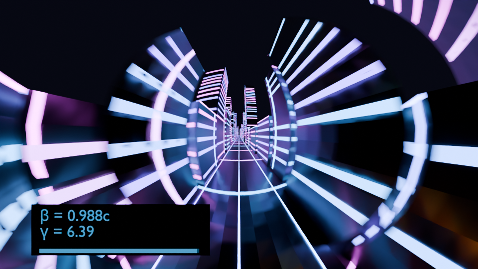
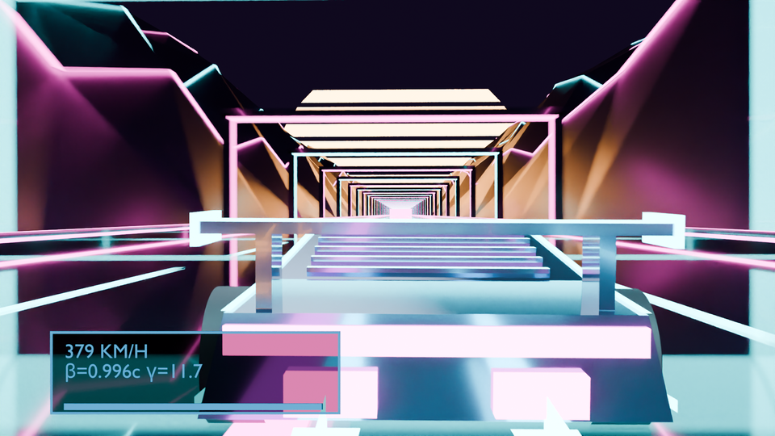
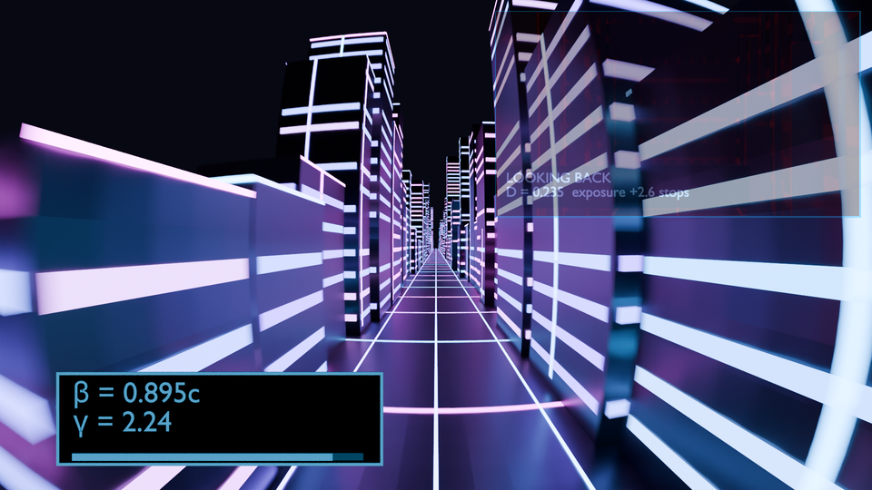
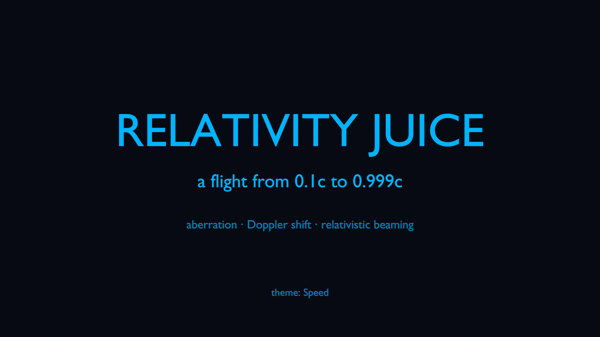
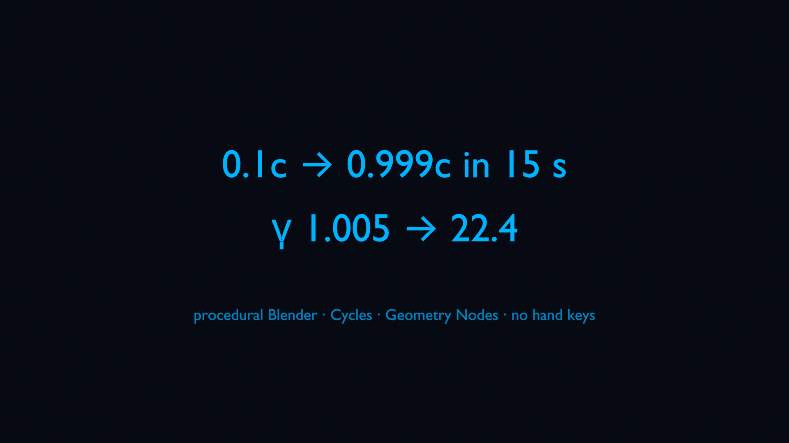
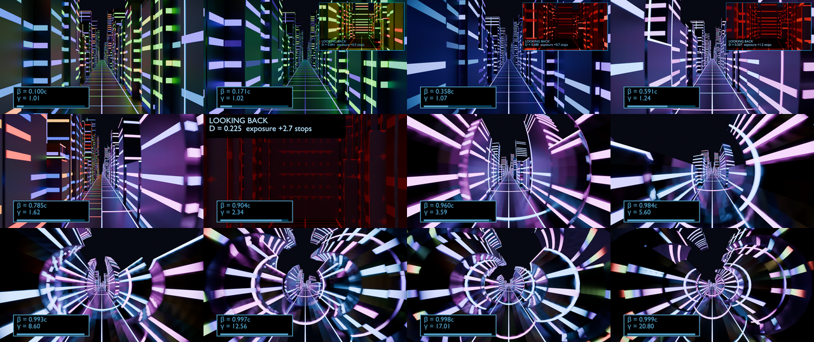
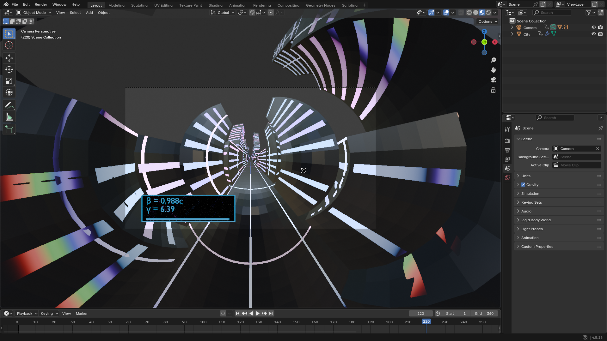

# relativity-juice

[](media/relativity-juice.mp4)

A 15-second procedural Blender animation: a cyberpunk megacity seen from a camera that accelerates from 0.1c to 0.999c, with the real special-relativity effects applied to what the camera sees. The effects shown are aberration, Doppler shift and beaming; Lorentz contraction appears through aberration, not as a separate step. The clip is 24 fps. Entry for the [RenderJuice Blender Animation & Programmatic Rendering Contest](https://programmatic-rendering-contest.devpost.com/), theme "Speed".

[Watch the video (media/relativity-juice.mp4)](media/relativity-juice.mp4)

What's in the video: a 2 s title card, the 15 s flight (360 frames), and a 2.5 s end card, joined with short fades through black (19.5 s in all). The sound bed is synthesized from γ(t): a drone that climbs in pitch with log γ and a noise rush that opens up with β.

| cruise, frame 48 | build, frame 150 |
| --- | --- |
|  |  |
| **blueshift, frame 220** | **singularity, frame 340** |
|  |  |

## Looking back



A rear-view inset (top-right, cyan border, fades in and out) shows what is behind the camera while the speed climbs: the city reddens, dims and empties out. That is the physics, not a filter. Aberration pulls every apparent direction toward the direction of travel, so the rear view empties. Dead behind, D = 1 / (γ(1 + β)): 0.90 at 0.1c, 0.23 at 0.9c, 0.022 at 0.999c. Observed wavelength is λ_rest / D, so warm windows slide into the infrared and the little light left is dimmed by the same D.

The inset is 800x450 (41.7% of the frame width, rendered at that size so nothing is upscaled) and stays up for frames 13 to 150 (ending at the first frame where β reaches 0.9; a test pins `REAR_END` to `beta_at`), except frames 107 to 142. Those 1.5 s are a split: the left half is the same camera with the warp off (what a Newtonian camera would see), the right half is the relativistic flight. Frames 151 to 180 then cut to the rear view full frame, and the flight returns for the 0.999c finish. Two honest display aids keep the red fade readable, and the label states both: "LOOKING BACK / D = 0.229  exposure +2.7 stops".

- **Exposure compensation.** The rear render gets a film exposure gain of 1.25 stops per halving of D (`exposure_stops` in `src/rear.py`, capped at 4 stops; the flight camera's exposure is untouched). It undoes most of the D² dimming but not all of it, so the inset still darkens as the speed climbs.
- **Near-IR tone-map.** Light shifted past 780 nm used to go to pure black (the shader's Wavelength node stops there), which no gain can lift. `display_infrared` in `src/relativity.py`, mirrored in the city shader, now shows it as a dim deep red: the red edge colour fades to 25% by 1000 nm and then falls as 1000 / λ_obs, so it keeps getting darker with D. Only the rear view ever gets there: anywhere ahead of the camera D ≥ γ > 1, so the forward flight frames are unchanged.

Measured on the city alone (96x54, 4 samples, mean luminance): 0.1c 0.178, 0.35c 0.067, 0.9c 0.028 with the gain (0.007 without it), against 0.279 for the forward view at 0.9c. The 0.9c rear view stays redder than the forward one (R/B 7.3 against 0.73), and a test requires at least 0.02 there. A skyline wall closes the street 300 to 330 units behind the start (`build_city`): without it the open end filled the middle of the inset with flat world colour, which also flattered these numbers.

It is a second camera ("RearCam", `src/rear.py`) locked to the flight camera's position and turned 180° about Z. The Warp modifier still aberrates about the flight camera, so the same scene serves both views. `bun run rear` renders its 800x450 frames to `out/rear` (resumable, GPU if there is one) and `bun run media` composites them over the flight frames for the window in `src/media.py` (`REAR_START`..`REAR_END`). `media/beat_lookback.png` is frame 148 (β 0.90), after the split and still inside the inset. `bun run newton` renders the unwarped half (frames 107 to 142, 1920x1080) to `out/newton`. `bun run rear:whip` renders the full-frame rear cut (frames 151 to 180, 1920x1080) to `out/rear-whip`. The media step takes the rear frames, the gauge frames, the newtonian frames and the whip frames: `python3 -m src.media [frames] [stills] [media] [cards] [rear] [hud] [newton] [whip]`. The cards are copied to `media/title.png` and `media/end.png`.

| title card | end card |
| --- | --- |
|  |  |

Every 30th frame of the final render:



Blender with the scene open at frame 220:



## What it is

Our reading of "Speed": speed is not only how fast something moves, it changes what you see. Near the speed of light a road ahead does not just rush past. Light from the world gets bent toward the direction of travel, forward windows shift to blue and then to ultraviolet, the rear world shifts to red and dies away, and the whole view collapses into a bright ring ahead. The animation lets you watch that happen as the speed climbs: calm at 0.1c, a visible bend by 0.5c, a tunnel by 0.9c, and a near-singularity at 0.999c. A gauge in the corner shows the current β and γ.

The city is a static neon canyon. Only the camera moves. The strange look is computed, not painted: the script moves every vertex of the city to where the camera would see it, and colours it by its Doppler shift.

Light is deliberately slow in the scene (C = 120 units per second) so a 15-second flight covers about 1400 units of city and the buildings stay readable instead of flashing by.

## The physics

All of it is in `src/relativity.py` (NumPy, no Blender) and mirrored in the Geometry Nodes modifier in `src/warp.py`. Tests check the node tree against the NumPy functions.

Setup: the camera moves along +Y at speed β = v/c. Everything else is at rest in the "city frame". θ is the angle between the direction to a point and +Y, measured in the city frame.

- Lorentz factor: γ = 1 / √(1 − β²). At 0.999c, γ ≈ 22.4.
- Where the clip ends: the last frame (360) is at t = 359/24 ≈ 14.96 s. The speed curve is flat there, so β is within 1e-6 of 0.999c and γ ≈ 22.4 (the gauge shows 0.999c); the curve lands exactly on β = 0.999c at t = 15 s, one frame later.
- Slow light: the scene speed of light is C = 120 units per second (`src/flight.py`), far slower than real life, so the 15 s flight covers about 1400 units.
- Speed curve (`beta_at`): the rapidity φ = atanh(β) is interpolated from atanh(0.1) to atanh(0.999) with a smoothstep over 15 s, then β = tanh(φ). Slow start, steady build, flat finish, and γ grows through the whole clip. The camera path is the integral of β·C over time (`camera_y`).
- Aberration: the apparent direction of a point is cos θ' = (cos θ + β) / (1 + β cos θ), and the part of the direction perpendicular to Y is scaled by 1 / (γ(1 + β cos θ)). Directions along ±Y do not move. As β rises, everything crowds toward the forward point.
- Doppler factor: D = γ(1 + β cos θ), with θ the city-frame angle above. In terms of the observed angle it is D = 1 / (γ(1 − β cos θ')). Observed wavelength is λ_obs = λ_rest / D. Dead ahead at 0.999c, D ≈ 45. Dead behind, D ≈ 0.022.
- Colour: visible wavelengths use a Bruton-style wavelength to RGB mapping. Below 380 nm (ultraviolet) the colour blends to a saturated violet-blue tinted by the source's rest colour, so windows of different colours stay distinguishable. Above 780 nm (infrared) the colour fades to black by 1000 nm.
- Beaming: true relativistic beaming scales intensity as D⁴. Applied as is, it blows the frame out to white. The brightness shown is a display tone-map, min(D², 2), applied to camera rays only, so light bouncing off walls stays at its rest brightness. It is a choice to keep the picture readable, not the physical intensity.
- Desaturation: past γ ≈ 5 the whole visible spectrum is squeezed into a thin ring near the frame edge, and a sharp band of pure green, yellow and red reads as a glitch rather than light. A second display tone-map mixes up to 35% grey into visible-band colours, fading in from γ 5 to 12 (`display_desaturation`). Wavelengths and hue order are unchanged.
- What the code does to the geometry: each vertex is moved along its new direction at the same distance from the camera (the warp changes direction, not range). Because the city is static, city-frame directions plus aberration give the exact visual for a point source. Lorentz contraction is not modelled as a separate step. What you see of it is the aberration: straight edges bend into curves and the scene stretches out and is pulled toward the forward point. Surfaces are subdivided (max edge 4 units, 2 on lit faces so the colour does not sweep the spectrum inside one face) so the per-vertex warp bends them smoothly, but they are still meshes, so very long faces are approximated.

## How to run

Needs Blender 4.5 LTS, Python 3 and `ffmpeg`. The tests and the Blender scripts run inside Blender's own Python, so no pip packages are needed.

```
bun install            # pyright for the typecheck
bun run test           # unittest suite inside headless Blender
bun run typecheck      # pyright over src/ scripts/ tests/
bun run smoke          # 64x36 Cycles CPU render to out/smoke/smoke.png, fails if flat
bun run preview        # CPU only: every 15th frame at 480x270 to out/preview.mp4
bun run render         # the full render, detached: frames to out/frames, log out/render.log, pid out/render.pid
bun run render:status  # frames done, whether the render is alive, last log line, eta
bun run render:wait    # block until 360/360 frames or the render process ends (--max-min N to give up)
bun run encode         # out/frames to out/relativity-juice.mp4 (H.264, 1920x1080, 24 fps)
bun run cards          # title and end cards to out/cards/title.png and end.png (Cycles CPU, Blender's bundled font)
bun run rear           # the rear-view inset frames to out/rear (800x450, resumable)
bun run newton         # unwarped frames 107-142 to out/newton (1920x1080, the left half of the split)
bun run rear:whip      # full-frame rear frames 151-180 to out/rear-whip (1920x1080)
bun run hud            # the gauge alone as transparent RGBA frames to out/hud (1920x1080, 8 samples, resumable)
bun run media          # runs cards, then overlays the rear view and the gauge (out/hud) and cuts title + out/frames + end card with the sound bed to media/relativity-juice.mp4, plus media/preview.gif, media/contact.png, media/beat_lookback.png, the cards and the beat stills
bun run wip            # Blender GUI screenshot of the scene to media/wip.png
```

`bun run render` is resumable: it skips frames that already exist, so run it again to continue after an interruption. A frame only gets its `.png` name once it is finished. `bun run media` refuses to run until all 360 frames, the rear frames and all 360 `out/hud` frames exist. It takes the rear and gauge folders as its fifth and sixth arguments: `bun run media out/frames out/stills media out/cards out/rear out/hud`.

Extra stills: `bun run still`, `still:warp`, `still:gauge` and `still:beats` render single frames to `out/stills/`.

Blender is found via the `BLENDER` env var, then `~/opt/blender/blender`, then `blender` on PATH (see `bin/blender`). ffmpeg and ffprobe are found via `FFMPEG` / `FFPROBE`, then `~/.local/bin`, then PATH (see `src/encode.py`). `bun run wip` uses your display if there is one, and otherwise runs Blender under `xvfb-run`.

## Workflow notes

Nothing is hand-modelled, hand-keyed or hand-painted. One script builds the whole scene each time, and the same code builds it for rendering, stills, tests and the screenshot (`build_scene` in `src/render.py`).

What the script controls:

- The city (`src/city.py`): a seeded random generator (seed 7) lays out buildings, windows, neon strips, street lines and the ground as one mesh. Each vertex carries a rest wavelength and an emission value as attributes.
- The warp (`src/warp.py`): a Geometry Nodes modifier, built node by node from Python, moves every vertex by the aberration formula and stores the Doppler factor per vertex. It reads the camera's position live.
- The speed: β is keyframed on the modifier at every frame from `beta_at`, and the camera's Y position is keyframed at every frame from the integral of β·C. Interpolation is linear between frames.
- The shader (`src/city.py`): a node material divides the rest wavelength by D, turns it into a colour, applies the UV tint and IR fade, and applies the display beaming to camera rays only.
- The gauge (`src/gauge.py`): a HUD of a text object, a bar and a thin cyan outline over a see-through dark backing, all parented to the camera. A `frame_change_pre` handler writes the current β and γ into the text and scales the bar every frame. In the baked forward frames that backing is see-through, so warped city geometry can cross the digits. `bun run hud` (`hud_only` in `src/gauge.py`) therefore renders the same gauge again on its own, transparent, with an opaque plate, and `bun run media` lays it over all 360 frames and the beat stills, so the digits always sit on a clean dark plate.
- The camera: a path along +Y at a fixed height, set from the flight code. Motion blur is on with shutter 0.3.
- Render settings: Cycles, 1920x1080, 48 samples, denoising, AgX view transform, near-black world, 24 fps, frames 1 to 360.
- The cut and sound (`scripts/cards.py`, `src/media.py`, `src/sound.py`): the cards are emissive text rendered by Blender, with the end card's β and γ computed from the flight. The sound is a drone and filtered noise written as a WAV with the standard library, pitch and loudness driven by a copy of `beta_at`, then muxed as AAC.

## How it was rendered

Locally, on one RTX 3090 with Cycles on CUDA. 1920x1080, 24 fps, 360 frames (15 s), 48 samples, denoised, motion blur with a 0.3 shutter. About 25 to 33 seconds per frame, 3 hours for the whole clip. It was not rendered on the RenderJuice cloud. The frames were then cut with the two cards and a synthesized sound bed (`src/sound.py`, plain Python) and encoded to H.264 + AAC with ffmpeg (`bun run media`). The cut adds 4.5 s around the 15 s render and needed no re-render.

## Assets and AI disclosure

- There are no third-party assets: no models, textures, HDRIs, music or samples. The sound bed is synthesized by our own script from γ(t), with no third-party audio or samples.
- The only font is Blender's bundled font, the default for text objects, used for the gauge and the title and end cards.
- No AI-generated images or video. Every pixel comes from the procedural script rendered by Cycles.
- The code, tests and this README were written with the help of an AI coding assistant (Claude). The physics follows standard special relativity.
- Tools: Blender 4.5 LTS (Cycles, Geometry Nodes), Python with NumPy (Blender's own), ffmpeg, Bun and pyright for the dev scripts.

## License

MIT, see LICENSE.
